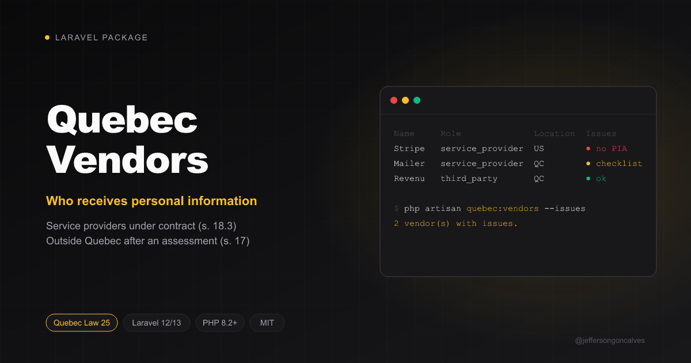

# Laravel Quebec Vendors



[](https://packagist.org/packages/jeffersongoncalves/laravel-quebec-vendors)
[](https://github.com/jeffersongoncalves/laravel-quebec-vendors/actions/workflows/tests.yml)
[](https://packagist.org/packages/jeffersongoncalves/laravel-quebec-vendors)

A register of the vendors you communicate personal information to, under Quebec's private sector privacy act (Law 25). It is part of the [laravel-quebec](https://github.com/jeffersongoncalves/laravel-quebec) suite.

- A **service provider** may receive personal information without the person's consent when it is necessary to carry out a mandate or a service contract, but only under a **written contract** that sets the measures to protect its confidentiality, limits its use to the mandate, forbids keeping it after the contract ends, requires the provider to notify your person in charge of any breach without delay, and lets you verify compliance (s. 18.3).
- Before communicating personal information **outside Quebec** (another province or a country), you must conduct a **privacy impact assessment** and may communicate it only if it would receive adequate protection, under a written agreement (s. 17).

Each vendor tracks its role, location, contract and checklist, assessment, risk tier and review date, and lists what it still owes.

> This package gives you tooling. It does not make you compliant on its own. You still need legal review, for example of each contract.

## Installation

```bash
composer require jeffersongoncalves/laravel-quebec-vendors
php artisan vendor:publish --tag="quebec-vendors-migrations"
php artisan migrate
php artisan vendor:publish --tag="quebec-vendors-config"
```

## Usage

```php
use JeffersonGoncalves\QuebecVendors\Enums\VendorRole;
use JeffersonGoncalves\QuebecVendors\Models\Vendor;

$vendor = Vendor::create([
    'name' => 'Stripe',
    'role' => VendorRole::ServiceProvider,
    'location' => 'US',                 // province (QC, ON...) or country
    'services' => 'Payments',
    'dpa_signed_at' => now(),
    'dpa_checklist' => ['confidentiality_measures' => true, 'mandate_only' => true],
]);

$vendor->issues();                // [AgreementIncomplete, AssessmentMissing]
$vendor->missingChecklistItems(); // ['no_retention', 'incident_notice', 'verification', 'outside_quebec_protection']

$vendor->update(['pia_completed_at' => now(), 'pia_reference' => 'PIA-2026-03']);
$vendor->markReviewed();
$vendor->terminate();
$vendor->confirmDataReturned();
```

| Issue | When |
|---|---|
| `AgreementMissing` | a service provider without a signed contract |
| `AgreementExpired` | the contract expired |
| `AgreementIncomplete` | an item of `quebec-vendors.dpa_checklist` is not ticked |
| `AssessmentMissing` | outside Quebec without a privacy impact assessment |
| `ReviewDue` | past the review period of its risk tier (`review_every`) |
| `DataReturnPending` | terminated, destruction or return not confirmed |

The `outside_quebec_protection` checklist item only applies to vendors outside Quebec. Record the assessment itself with [laravel-quebec-pia](https://github.com/jeffersongoncalves/laravel-quebec-pia).

```bash
php artisan quebec:vendors
php artisan quebec:vendors --issues --json
```

## Testing

```bash
composer test
```

## Changelog

See [CHANGELOG](CHANGELOG.md).

## License

The MIT License (MIT). See [License File](LICENSE.md).
